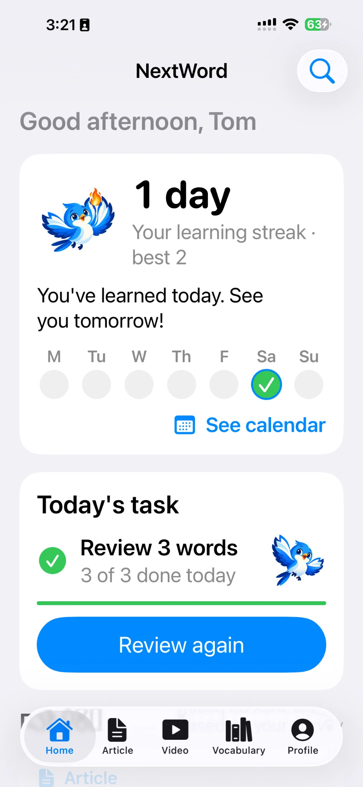
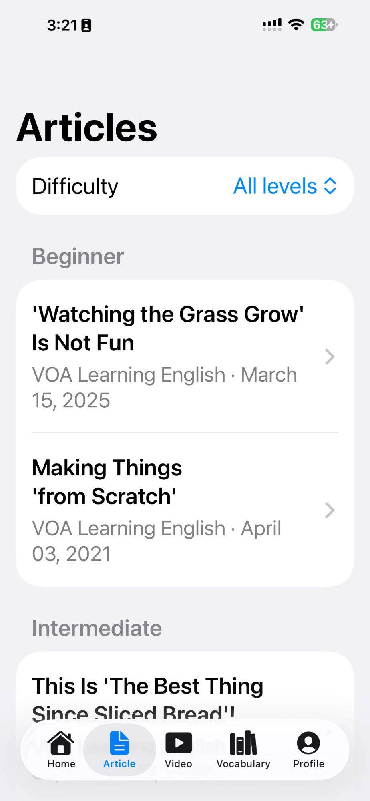
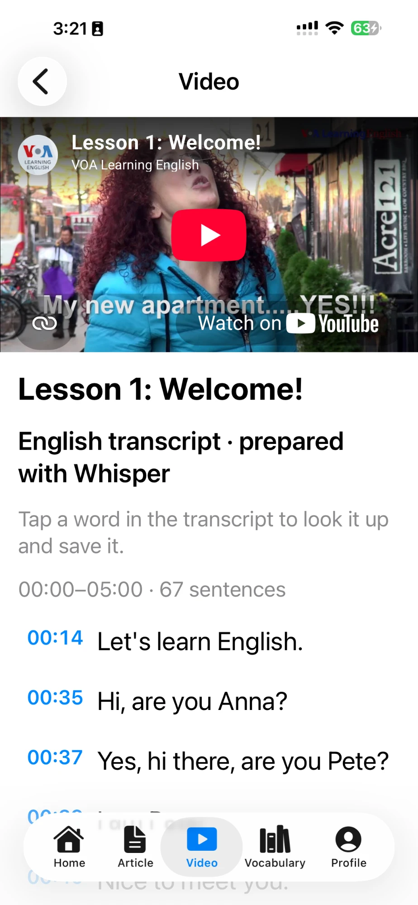
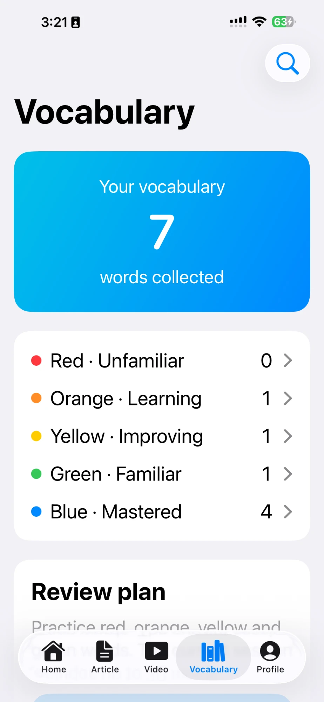
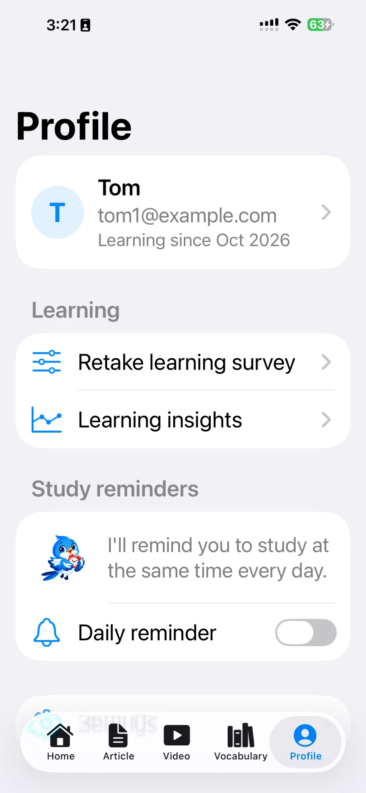

# NextWord

An iOS app for learning English vocabulary from real articles and videos.
Tap any word while you read or watch, save it with a colour that shows how well you know it,
and review it until it turns blue.

Built with **SwiftUI**, **SwiftData**, **Swift Charts** and **Firebase**.

## App tour

<table>
  <tr>
    <td width="260"></td>
    <td valign="top">
      <h3>Home</h3>
      <p>The daily starting point. The bird and the week row show your learning streak,
      and <b>Today's task</b> turns the review plan into a goal such as "Review 3 words", with a progress bar.</p>
      <p>Further down, <b>For you</b> recommends one article and one video that match your level and interests
      from the learning survey.</p>
    </td>
  </tr>
  <tr>
    <td></td>
    <td valign="top">
      <h3>Articles</h3>
      <p>Short VOA Learning English stories grouped by difficulty, with a filter at the top.</p>
      <p>Inside an article every English word is tappable. A sheet opens with the offline dictionary entry and a
      Chinese translation, and you save the word with a colour. Saved words stay highlighted in their colour as you read.</p>
    </td>
  </tr>
  <tr>
    <td></td>
    <td valign="top">
      <h3>Video</h3>
      <p>A YouTube lesson with a transcript prepared by Whisper. Each sentence has its start time.</p>
      <p>While the video plays, the current sentence is highlighted and scrolled to the centre. Words in the
      transcript open the same word sheet as articles, so videos feed the same vocabulary.</p>
    </td>
  </tr>
  <tr>
    <td></td>
    <td valign="top">
      <h3>Vocabulary</h3>
      <p>Every saved word sits in one of five colours: <b>red</b> (unfamiliar), <b>orange</b>, <b>yellow</b>,
      <b>green</b> and <b>blue</b> (mastered).</p>
      <p>A review session shows one card at a time. Remembering a word moves it up one colour, forgetting moves it
      down one, and blue words leave the review plan.</p>
    </td>
  </tr>
  <tr>
    <td></td>
    <td valign="top">
      <h3>Profile</h3>
      <p>Your Firebase account, the learning survey you can retake, and <b>Learning insights</b> with a streak
      calendar, review accuracy and stage charts.</p>
      <p>The <b>daily reminder</b> sends a local notification at your chosen time, with a "Remind me in 1 hour"
      action. Settings, the About page, the privacy policy and account deletion are here too.</p>
    </td>
  </tr>
</table>

## Features

- **Read and watch, then tap a word.** Articles from VOA Learning English and YouTube videos with a
  synchronised transcript. Every word is tappable and opens an offline dictionary entry plus a
  Chinese translation.
- **Five-colour review.** Each saved word is red, orange, yellow, green or blue. Remembering a word
  moves it up one colour; forgetting moves it down one. Blue words are mastered.
- **Synchronised video transcripts.** The sentence being spoken is highlighted and scrolled into view
  as the video plays.
- **Accounts and sync.** Email sign-in with Firebase. Survey answers and settings follow you to a new
  phone, and every account on the same phone keeps its own words.
- **Personalised start.** A short learning survey sets your level, interests and study time, and the
  Home screen recommends an article and a video to match.
- **Daily reminder.** A local notification at your chosen time, with a "Remind me in 1 hour" action.
- **Progress.** Learning streak, a monthly calendar, review accuracy and stage charts.
- **Accessibility and privacy.** VoiceOver labels, Dynamic Type layouts, Reduce Motion support,
  dark mode, a privacy manifest and in-app account deletion.

## Tech stack

| Area | Technology |
| --- | --- |
| UI | SwiftUI, Swift Charts |
| Local data | SwiftData (one store per account), `@AppStorage` with a per-account `UserDefaults` suite |
| Accounts and sync | Firebase Authentication, Cloud Firestore (firebase-ios-sdk 13) |
| Video | `WKWebView` + YouTube IFrame Player API, with a JavaScript bridge to Swift |
| Dictionary | Bundled [Wordset](https://github.com/wordset/wordset-dictionary) JSON, loaded by an `actor` one letter at a time |
| Translation | [DeepL API](https://www.deepl.com/pro-api) via `URLSession` and `async/await` |
| Reminders | UserNotifications: a repeating calendar trigger, plus a snooze action |
| Transcripts (offline tool) | Python, [yt-dlp](https://github.com/yt-dlp/yt-dlp), [FFmpeg](https://ffmpeg.org), [OpenAI Whisper](https://github.com/openai/whisper) |

## How it works

### Synchronised transcripts without running speech recognition on the phone

Transcripts are prepared **before** the app is built. `tools/generate_whisper_demo.py` downloads the
audio with yt-dlp, converts it with FFmpeg, runs Whisper with word timestamps, groups the words into
sentences and writes a JSON file that is bundled with the app.

At playback time, `YouTubePlayerView` hosts the YouTube iframe in its own HTML page. A small script
reads the player's current time every 250 ms and posts it to Swift through a `WKScriptMessageHandler`.
Only messages from the main frame are accepted. `VideoView` then finds the sentence whose
`start <= time < end`, highlights it and scrolls it to the centre.

### One database per account

`AccountStore` gives every signed-in user their own SwiftData file (`Accounts/<uid>.store`) and their
own `UserDefaults` suite. `RootView` rebuilds the signed-in screen with `.id(uid)`, so switching
accounts opens a fresh container and two people on the same phone never see each other's words.
After sign-in, `PreferencesSync` restores the survey answers from Firestore before deciding whether
the survey is needed.

### Account deletion in a safe order

`AuthService.deleteAccount(password:)` reauthenticates, deletes the Firestore profile while the
security rules still allow it, deletes the Firebase account, and only then removes local data. An
error part-way through never leaves the user with lost local data and a live account.

## Getting started

Requirements: Xcode 27 or later and iOS 26.5 or later (iPhone or iPad).

1. Clone the repository and open `NextWord.xcodeproj`.
2. Select your own development team under **Signing & Capabilities**.
3. Run the app.

### Optional: translation

Word translations use DeepL. Without a key the app still runs, and the word sheet shows
"Translation unavailable". To enable it, create `NextWord/LocalSecrets.plist` (it is git-ignored):

```xml
<?xml version="1.0" encoding="UTF-8"?>
<!DOCTYPE plist PUBLIC "-//Apple//DTD PLIST 1.0//EN" "http://www.apple.com/DTDs/PropertyList-1.0.dtd">
<plist version="1.0">
<dict>
    <key>DeepLAPIKey</key>
    <string>YOUR_DEEPL_API_KEY</string>
</dict>
</plist>
```

A free key is available from [DeepL](https://www.deepl.com/pro-api).

### Optional: your own Firebase project

The repository includes the `GoogleService-Info.plist` of the demo Firebase project. To use your own,
create a Firebase iOS app with your bundle identifier, enable **Email/Password** sign-in and
**Cloud Firestore**, and replace the file. Firestore rules should only let a user read and write
their own profile:

```
match /users/{uid} {
  allow read, write: if request.auth != null && request.auth.uid == uid;
}
```

### Generating a new transcript

See [`tools/README.md`](tools/README.md).

## Project structure

```
NextWord/
├── Account/         Sign-in state, per-account storage, Firestore sync, account deletion
├── Article/         Article list, reader and the shared word sheet
├── Video/           Video list, YouTube player bridge, timed transcript
├── Vocabulary/      Saved words, review session, dictionary and translation services
├── Notifications/   Daily reminder scheduling and settings
├── Home/            Streak, today's task, recommendations
├── Profile/         Profile, learning survey, insights charts, settings, about, privacy policy
├── Components/      Mascot and other shared views
├── ContentCatalog.swift, RecommendationRules.swift
└── PrivacyInfo.xcprivacy
tools/               Offline transcript generator (Python)
```

## Background

NextWord began as my individual project for **FIT3178 iOS App Development** at Monash University
(September–November 2026) and was moved here from the university GitLab with its full commit history.
Parts of the Firebase and notification code are based on the unit's Week 6 and Week 10 labs.
Claude (Anthropic) was used as a coding assistant; I reviewed, tested and can explain all of the code.

## Credits

- Articles: [VOA Learning English](https://learningenglish.voanews.com)
- Videos: belong to their original YouTube creators and are used for learning only
  (each is credited on the app's About page)
- Dictionary: Wordset, based on WordNet, CC BY-SA 4.0
  ([notice](NextWord/Vocabulary/Wordset/WORDSET-NOTICE.txt))
- Translation: DeepL API
- Accounts and sync: Firebase iOS SDK (Apache 2.0)
- Transcript tools: OpenAI Whisper (MIT), yt-dlp (Unlicense), FFmpeg (LGPL); used on a Mac only,
  not shipped in the app

## License

The source code is released under the [MIT License](LICENSE). Bundled articles, video transcripts,
dictionary data and artwork keep their own terms; see the note at the end of the licence.

## Author

Xiaoyu (Tom) Zhou · [GitHub @TOMZhou0506](https://github.com/TOMZhou0506)
